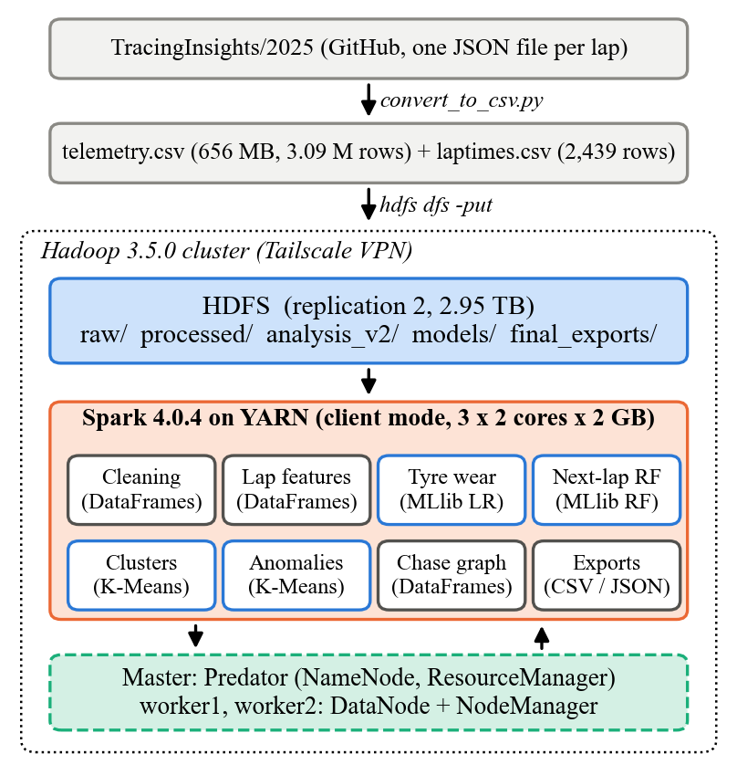
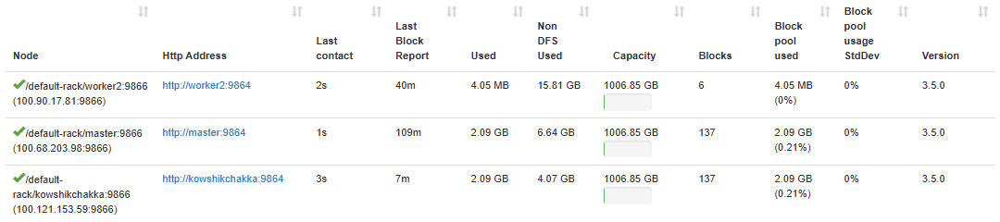
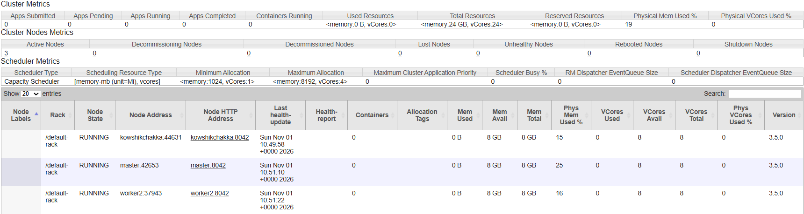
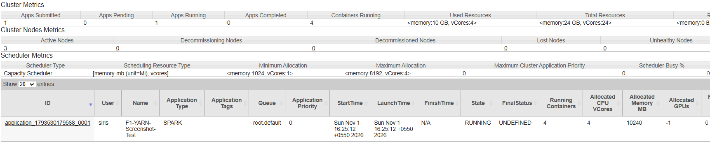
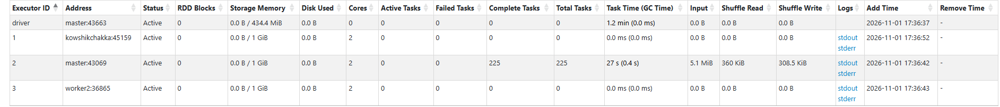
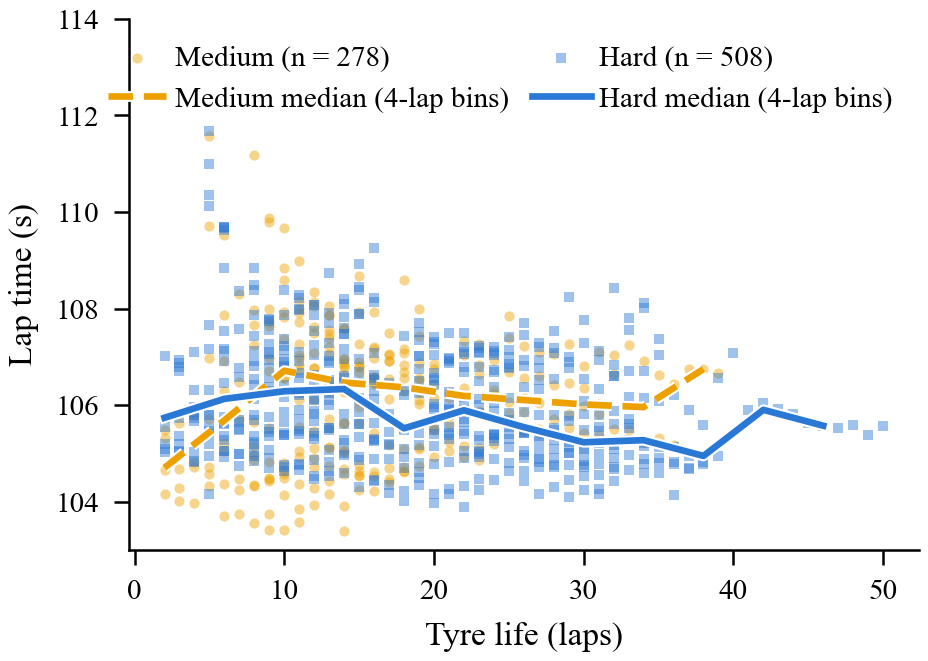
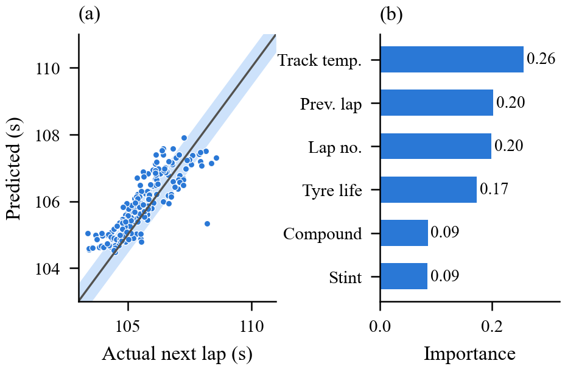
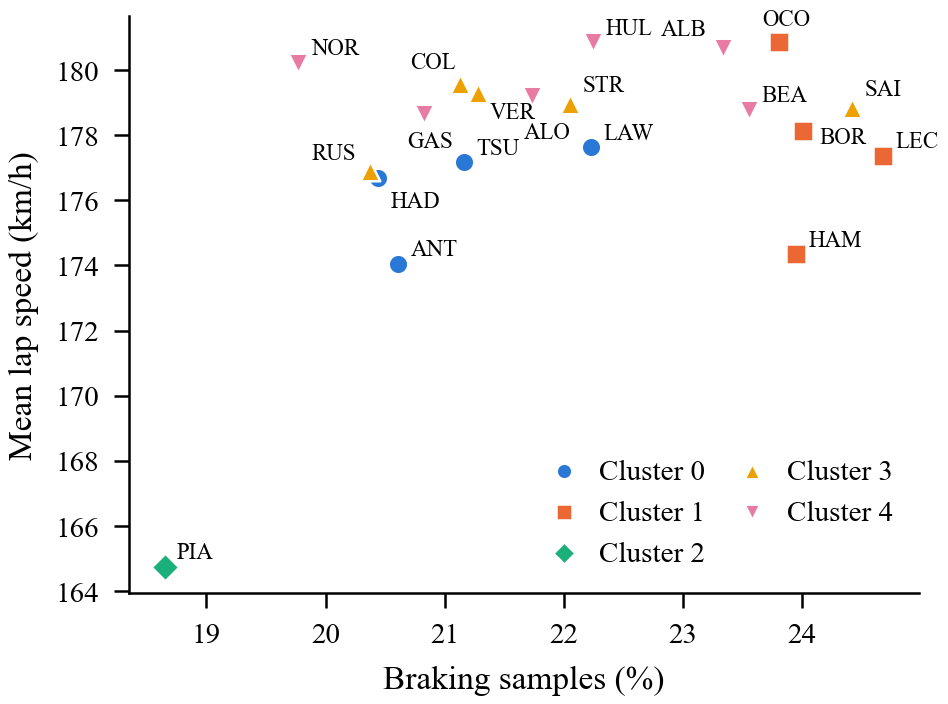
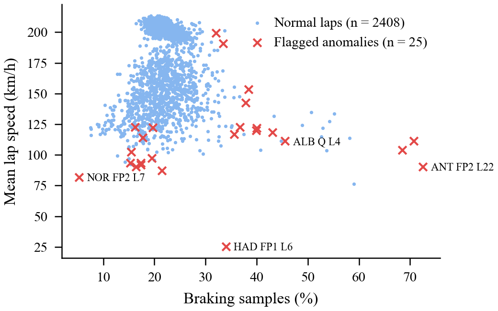

::: {custom-style="Title"}
Analysis of Formula 1 Telemetry Data from the 2025 Azerbaijan Grand Prix Using Apache Spark on a Hadoop Cluster
:::

| Sai Akshay Oggisetty |
|:---:|
| Dept. of Data Science and Computer Applications |
| Manipal Institute of Technology, Manipal, India |

::: {custom-style="Course Line"}
Big Data Analytics (DSE 3125) Mini Project, Semester V, Section DSE-A
:::

::: {custom-style="Abstract"}
***Abstract*—A Formula 1 car records speed, engine, driver-input and position data several times per second, so a single race weekend produces millions of records. This project builds an end-to-end big data pipeline for the 2025 Azerbaijan Grand Prix. The data covers all five sessions and comes from the public TracingInsights/2025 repository: 3,092,689 telemetry records (656 MB) and 2,439 lap records. It is stored in HDFS on a three-node Hadoop cluster and processed by PySpark applications running on YARN. Spark DataFrames are used to clean the data and to build a lap-level feature table. Spark MLlib is used to estimate tyre degradation with linear regression, predict the next lap time with a random forest, group drivers by driving style with K-Means, and flag anomalous laps by their distance to K-Means centroids. A driver-following ("chase") graph is built from the gap-to-car-ahead channel. On held-out race laps the random forest predicts the next lap with a mean absolute error of 0.535 s (R² = 0.633).**
:::

::: {custom-style="Abstract"}
***Index Terms*—Big data, Apache Spark, Hadoop, HDFS, YARN, MLlib, Formula 1, telemetry, random forest, K-Means, anomaly detection.**
:::

# I. Introduction

Formula 1 is one of the most data-intensive sports. The public timing feed alone gives each car's speed, engine speed (RPM), gear, throttle, brake, DRS state and position on the circuit, sampled several times per second, for every car in every session. Teams and analysts use this data to compare drivers, understand tyre wear and plan race strategy.

For one Grand Prix weekend the telemetry already exceeds three million records (656 MB as CSV). Joining it with lap data, computing per-lap aggregates and training several models becomes slow and memory-bound on a single laptop. Hadoop, with its distributed file system HDFS [6] and resource manager YARN [5], and Spark address this kind of workload by splitting the data into blocks, storing them on several machines and processing them in parallel close to where they are stored [2], [3].

This project applies these tools to the 2025 Azerbaijan Grand Prix on the Baku City Circuit, a 6.003 km street circuit with a 2.2 km flat-out section and a narrow old-town section. A three-node Hadoop cluster was set up, the data was loaded into HDFS, and all processing was done with PySpark jobs submitted to YARN.

# II. Problem Statement and Objectives

## A. Problem Statement

The project processes and analyses the telemetry and lap-time data of the 2025 Azerbaijan Grand Prix in a distributed Hadoop and Spark environment, in order to study driver, lap, session and vehicle performance. Specifically, it asks: how quickly does each tyre compound degrade; can the next lap time be predicted from the current state of the car; how do driving styles differ between drivers; which laps show unusual telemetry; and which drivers spent the most time racing closely behind which others.

## B. Objectives

1. Store the telemetry and lap-time data sets in HDFS on a multi-node Hadoop cluster.
2. Process the data with Apache Spark running on YARN.
3. Use Spark DataFrames/SQL for cleaning and feature engineering, and Spark MLlib for modelling.
4. Quantify tyre degradation, next-lap predictability, driver-style groups, anomalous laps and close-following behaviour.

# III. Dataset Description

The data comes from the TracingInsights/2025 GitHub repository [1], which publishes Formula 1 data for the 2025 season extracted from the official live-timing feed. The repository is released under the Apache License 2.0 and archived on Zenodo (DOI 10.5281/zenodo.17312803). It contains only public sporting information, so no personal data needed to be anonymised.

The repository stores each lap of each driver as a separate JSON file. A Python script (`convert_to_csv.py`) downloads all files of the event with 16 parallel workers and flattens them into two CSV files (Table I). The telemetry file has 22 columns: year, event, session, driver and lap; time, RPM, speed, gear, throttle, brake, DRS, distance and relative distance; the car ahead and the distance to it; three acceleration components; and x, y, z position. The lap file has 45 columns, including lap and sector times, tyre compound, tyre life, stint, position, pit times, track status and weather. With more than three million records and 656 MB, the data set meets the course requirement of 500 MB.

::: {custom-style="Table Caption"}
TABLE I\
DATASET SIZE BY SESSION
:::

| Session | Telemetry rows | Laps |
|---|--:|--:|
| Practice 1 | 568,006 | 325 |
| Practice 2 | 554,362 | 434 |
| Practice 3 | 454,693 | 377 |
| Qualifying | 710,848 | 335 |
| Race | 804,780 | 968 |
| **Total** | **3,092,689** | **2,439** |

# IV. Architecture and Cluster Configuration

Fig. 1 shows the pipeline. The CSV files are uploaded to HDFS. Every processing step is a PySpark application submitted to YARN in client mode, and results are written back to HDFS as Parquet before being exported to CSV/JSON.

{width=3.3in}

::: {custom-style="Figure Caption"}
Fig. 1. System architecture and data pipeline.
:::

The three machines are connected through a Tailscale virtual private network (Table II). The master runs Ubuntu 24.04 under WSL2 and, like both workers, also runs a DataNode and a NodeManager. The Spark libraries are staged once in HDFS (`spark.yarn.archive`), so they are not uploaded again for every application.

::: {custom-style="Table Caption"}
TABLE II\
CLUSTER CONFIGURATION
:::

| Item | Value |
|---|---|
| Master | Predator: NameNode, ResourceManager, DataNode, NodeManager |
| Workers | worker1 (kowshikchakka), worker2 (LAPTOP-0R1PU807): DataNode, NodeManager |
| Master hardware | Intel Core i5-13500HX, 7.6 GB RAM (WSL2) |
| Versions | Hadoop 3.5.0, Spark 4.0.4, OpenJDK 17, Python 3.12.3 |
| HDFS | 2.95 TB configured, replication factor 2 |
| YARN | 24 GB, 24 vCores (8 GB / 8 vCores per node) |
| Spark job | 3 executors × 2 cores × 2 GB, client mode |

# V. Methodology

All jobs are written in PySpark and run with `spark-submit --master yarn --deploy-mode client`. Two Spark components are used: Spark SQL/DataFrames [7] and Spark MLlib [4].

## A. Data Cleaning

The raw CSV is read from HDFS with an explicit schema, which avoids a schema-inference pass over the 656 MB file. Samples are kept only if the lap is positive, the speed is at least 5 km/h, the x/y position is valid and non-zero, and brake and DRS are 0 or 1. Throttle is clamped to 0–100 % and gears outside 0–8 are set to null. An acceleration-magnitude column is added, and the output is written as 12 Parquet partitions.

```python
clean = df.filter(
    (col("lap") > 0) & (col("speed") >= 5)
    & (col("x") != 0) & (col("y") != 0)
    & col("brake").isin(0, 1)
    & col("drs").isin(0, 1))
```

Of 3,092,689 samples, 2,273,155 (73.5 %) were kept. Most removed samples were recorded while the car was stationary or in the garage. A further 569,305 throttle values were clamped and 3,282 invalid gears were nulled.

## B. Lap Feature Engineering

The cleaned telemetry is aggregated to one row per (session, driver, lap) with `groupBy().agg()`: minimum, mean and maximum speed, mean RPM, mean throttle, the share of samples with brakes on and with DRS open, and mean acceleration. This is joined with the lap file to add lap time, compound, tyre life, stint, track status, pit times and weather. A lap is a *pit lap* if it has a pit-in or pit-out time, and a *push lap* if it is accurate, run under green flag and not a pit lap. The result has 2,433 laps, of which 1,156 are push laps.

## C. Tyre Degradation

For each compound, an MLlib linear regression `lap_time = b0 + b1·tyre_life + b2·lap` is fitted on push laps. The age coefficient b1 is the time lost per lap of tyre age, and the lap coefficient b2 absorbs fuel burn-off.

## D. Next-Lap Prediction

Window functions `lag` and `lead` over (session, driver) ordered by lap add the previous and next lap times. The features are previous lap time, tyre life, stint, track temperature, lap number and compound (`StringIndexer`). A `RandomForestRegressor` [8] with 80 trees and depth 8 is trained on the first 80 % of rows (772) and tested on the remaining 20 % (193, all race laps), and evaluated with MAE, RMSE and R².

```python
w = (Window.partitionBy("session", "driver")
     .orderBy("lap"))
df = (df
  .withColumn("previous_lap_time",
              lag("lap_time").over(w))
  .withColumn("next_lap_time",
              lead("lap_time").over(w)))
```

## E. Driver Clustering

Each driver's lap features are averaged over all sessions (seven features), standardised with `StandardScaler` and clustered with K-Means [9] for K = 2–5. The K with the highest silhouette score [10] is kept.

## F. Anomaly Detection

All laps are standardised and clustered with K-Means (K = 5). The anomaly score of a lap is its squared distance to its cluster centroid, and laps above the 99th percentile (`percentile_approx`) are flagged.

## G. Chase Graph

Each telemetry sample names the car ahead and the gap to it. Samples with a gap under 50 m become directed edges "driver → car ahead". Grouping the edges gives, per pair, the number of close samples, the time within 50 m and the minimum gap. In- and out-degree tables are computed with DataFrame aggregations.

# VI. Results and Discussion

## A. Cluster Operation

Figs. 2–5 show the cluster running the pipeline. All three DataNodes are in service (Fig. 2). YARN reports three running NodeManagers with 24 GB and 24 vCores in total (Fig. 3). The Spark jobs appear as YARN applications (Fig. 4), and their executors run on all three nodes (Fig. 5).

::: {custom-style="Wide Figure"}
{width=5.2in}
:::

::: {custom-style="Figure Caption"}
Fig. 2. HDFS NameNode UI: the three DataNodes (worker2, master, kowshikchakka) in service, Hadoop 3.5.0.
:::

::: {custom-style="Wide Figure"}
{width=7in}
:::

::: {custom-style="Figure Caption"}
Fig. 3. YARN ResourceManager UI: three active, running NodeManagers with 24 GB and 24 vCores in total.
:::

::: {custom-style="Wide Figure"}
{width=7in}
:::

::: {custom-style="Figure Caption"}
Fig. 4. YARN applications list: a Spark application running in the root.default queue.
:::

::: {custom-style="Wide Figure"}
{width=7in}
:::

::: {custom-style="Figure Caption"}
Fig. 5. Spark UI: the driver on the master and executors on kowshikchakka (worker1), master and worker2.
:::

As a check on the data, the race classification computed from the lap table matches the official result: Verstappen won ahead of Russell (+14.714 s) and Sainz (+19.280 s), and set the fastest race lap (1:43.388). The fastest lap of the weekend was Verstappen's 1:41.117 in qualifying.

## B. Tyre Degradation

::: {custom-style="Table Caption"}
TABLE III\
TYRE DEGRADATION BY COMPOUND (ALL SESSIONS)
:::

| Compound | Laps | Age coef. (s/lap) | Lap coef. (s/lap) | R² |
|---|--:|--:|--:|--:|
| Soft | 235 | +0.396 | +0.170 | 0.016 |
| Medium | 369 | −0.041 | −0.094 | 0.078 |
| Hard | 550 | +0.002 | −0.130 | 0.147 |

The soft tyre loses about 0.4 s per lap of age, the most of the three compounds (Table III). Once the lap term is included, the medium and hard tyres show almost no degradation. Their negative lap effect (about 0.1 s per lap) is the fuel burn-off: the car gets lighter, and therefore faster, as the race goes on, which masks the tyre wear.

Fig. 6 shows this in the race, where only medium and hard tyres were used. The median lap time does not rise with tyre age. On the hard tyre it falls by about 1 s between laps 10 and 38 of a stint. The low R² values show that tyre age and lap number explain little of the lap-time variance when all sessions are pooled. Fuel load, engine modes and traffic, which the data does not record directly, dominate.

{width=3.3in}

::: {custom-style="Figure Caption"}
Fig. 6. Race push-lap times against tyre life, with medians over 4-lap bins (Safety Car laps above 112 s removed).
:::

## C. Next-Lap Prediction

On the 193 held-out race laps, the random forest has an MAE of 0.535 s, an RMSE of 0.648 s and an R² of 0.633. This is about 0.5 % of a 1:45 lap. Most predictions fall within the ±MAE band in Fig. 7(a). The model underestimates the slowest laps, which are usually caused by traffic or mistakes that the features cannot capture.

Track temperature has the highest importance (Fig. 7(b)), but this needs care. Temperatures above 28.4 °C occur only in practice, so the feature mainly tells the model which session a lap belongs to. Previous lap time and lap number, which carries the fuel effect, are the next most useful features.

{width=3.3in}

::: {custom-style="Figure Caption"}
Fig. 7. Random forest: (a) predicted vs. actual next lap on the test set, with the ±MAE band shaded; (b) feature importance.
:::

## D. Driver Style Clusters

The silhouette search selected K = 5 (Table IV, Fig. 8). Cluster 1 (Hamilton, Leclerc, Bortoleto, Ocon) has the highest braking share, about 24 %. Cluster 4 has the highest mean speed and DRS usage (7.0 %), consistent with time spent in midfield DRS trains. Cluster 3 contains the top three finishers (Verstappen, Russell, Sainz) and has the lowest DRS usage, consistent with running in clean air. Piastri forms a cluster of his own because he crashed on lap 1, so his averages come almost entirely from practice. With only 20 drivers, and with car performance mixed into the averages, the clusters describe groups of similar laps rather than pure driving style.

::: {custom-style="Table Caption"}
TABLE IV\
K-MEANS DRIVER CLUSTERS (K = 5)
:::

| C | Drivers | Speed (km/h) | Brake (%) | DRS (%) |
|---|---|--:|--:|--:|
| 0 | ANT, HAD, LAW, TSU | 176.4 | 21.1 | 5.0 |
| 1 | BOR, HAM, LEC, OCO | 177.7 | 24.1 | 6.0 |
| 2 | PIA | 164.7 | 18.6 | 6.8 |
| 3 | COL, RUS, SAI, STR, VER | 178.7 | 21.9 | 4.9 |
| 4 | ALB, ALO, BEA, GAS, HUL, NOR | 179.7 | 21.9 | 7.0 |

{width=3.3in}

::: {custom-style="Figure Caption"}
Fig. 8. Drivers by braking share and mean lap speed, marked by K-Means cluster.
:::

## E. Telemetry Anomalies

The 99th-percentile threshold (score ≈ 13.3) flagged 25 of the 2,433 laps (Fig. 9). The top-scoring lap is Hadjar's Practice 1 lap 6, with the car crawling at a mean speed of 25 km/h. It is followed by a Practice 2 lap of Antonelli with 73 % braking samples, Albon's aborted qualifying lap, and very slow cool-down laps. The Safety Car laps at the start of the race are also flagged. None of these is a sensor fault. They are real but unusual running conditions, so a simple unsupervised method finds the laps an analyst would want to remove or investigate.

{width=3.3in}

::: {custom-style="Figure Caption"}
Fig. 9. All laps by braking share and mean speed; the 25 flagged anomalies are marked with crosses.
:::

## F. Chase Graph

The graph has 20 vertices and 380 directed edges, built from 320,530 samples in which a car was within 50 m of the car ahead (Table V). Hülkenberg spent the most time chasing (out-weight 27,932 samples), and Stroll the most time defending (in-weight 30,284). The Antonelli–Lawson pair spent about 250 s within 50 m of each other, and they finished fourth and fifth. Because the graph pools all sessions, part of each edge comes from practice traffic.

::: {custom-style="Table Caption"}
TABLE V\
STRONGEST CHASE EDGES
:::

| Chaser → Ahead | Samples | Time < 50 m (s) |
|---|--:|--:|
| HUL → STR | 19,185 | 122.1 |
| NOR → TSU | 9,877 | 194.2 |
| NOR → LEC | 8,997 | 128.5 |
| BEA → HUL | 8,246 | 92.6 |
| ANT → LAW | 7,312 | 249.7 |

All result tables are exported from HDFS as CSV and JSON. These exports feed the project's Power BI report and interactive web dashboard.

# VII. Conclusion and Future Work

This project built a complete Spark pipeline for Formula 1 telemetry on a three-node Hadoop cluster. The 3.09-million-record data set was stored in HDFS and processed on YARN. Cleaning removed 26.5 % of the samples, and the rest were aggregated into a 2,433-lap feature table. The findings are:

- The soft tyre degraded by about 0.4 s per lap, while for the medium and hard tyres the fuel burn-off outweighed the wear.
- A random forest predicts the next race lap with an MAE of 0.535 s.
- Drivers separate mainly by braking share and DRS usage.
- Distance-based anomaly detection isolates stopped cars, aborted laps and Safety Car laps.

*Limitations:* only one event was analysed. The next-lap model splits by row order rather than by time. Track temperature acts as a proxy for the session. The clustering uses only 20 points. The master node has only 7.6 GB of RAM.

*Future work:* extend the pipeline to all 24 races of the season (about 75 million samples); add fuel-corrected degradation models; use Spark Structured Streaming on the live-timing feed; and run PageRank and community detection on season-wide chase graphs with GraphFrames.

# References

::: {custom-style="Reference"}
[1] TracingInsights, "TracingInsights-Archive/2025: Formula 1 2025 season data," GitHub repository, 2025. [Online]. Available: https://github.com/TracingInsights/2025, doi: 10.5281/zenodo.17312803.

[2] T. White, *Hadoop: The Definitive Guide*, 4th ed. Sebastopol, CA, USA: O'Reilly Media, 2015.

[3] M. Zaharia *et al.*, "Apache Spark: A unified engine for big data processing," *Commun. ACM*, vol. 59, no. 11, pp. 56–65, Nov. 2016.

[4] X. Meng *et al.*, "MLlib: Machine learning in Apache Spark," *J. Mach. Learn. Res.*, vol. 17, no. 34, pp. 1–7, 2016.

[5] V. K. Vavilapalli *et al.*, "Apache Hadoop YARN: Yet another resource negotiator," in *Proc. 4th ACM Symp. Cloud Comput.*, Santa Clara, CA, USA, 2013, pp. 1–16.

[6] K. Shvachko, H. Kuang, S. Radia, and R. Chansler, "The Hadoop distributed file system," in *Proc. IEEE 26th Symp. Mass Storage Syst. Technol.*, Incline Village, NV, USA, 2010, pp. 1–10.

[7] M. Armbrust *et al.*, "Spark SQL: Relational data processing in Spark," in *Proc. ACM SIGMOD Int. Conf. Manage. Data*, Melbourne, VIC, Australia, 2015, pp. 1383–1394.

[8] L. Breiman, "Random forests," *Mach. Learn.*, vol. 45, no. 1, pp. 5–32, Oct. 2001.

[9] S. Lloyd, "Least squares quantization in PCM," *IEEE Trans. Inf. Theory*, vol. 28, no. 2, pp. 129–137, Mar. 1982.

[10] P. J. Rousseeuw, "Silhouettes: A graphical aid to the interpretation and validation of cluster analysis," *J. Comput. Appl. Math.*, vol. 20, pp. 53–65, Nov. 1987.
:::
